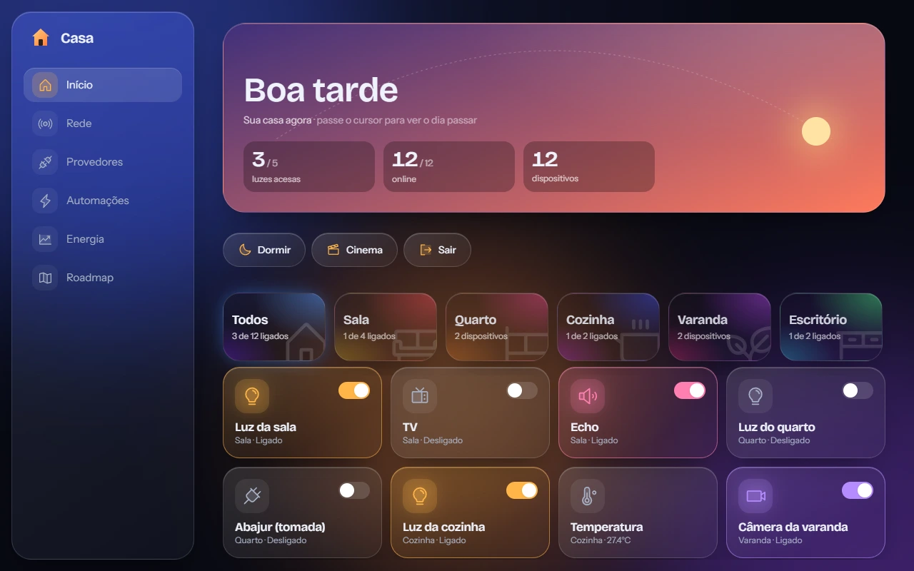
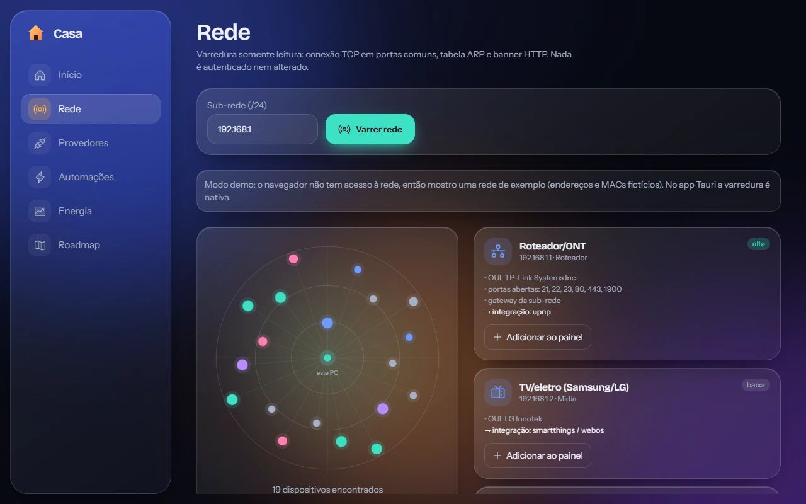
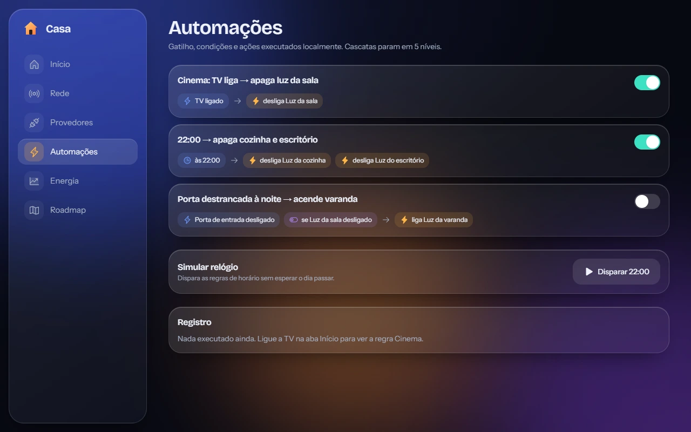
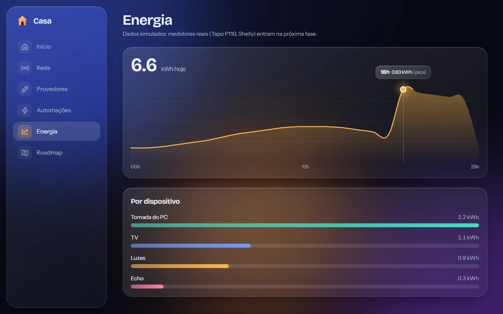
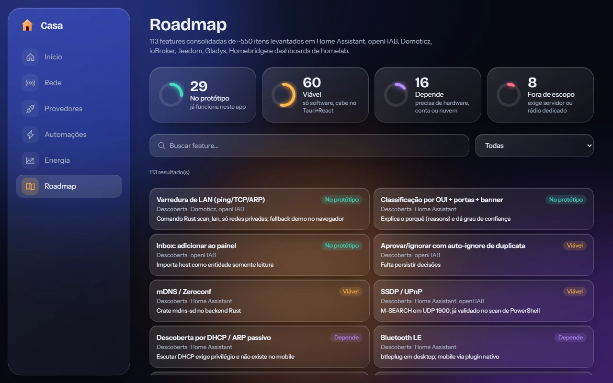
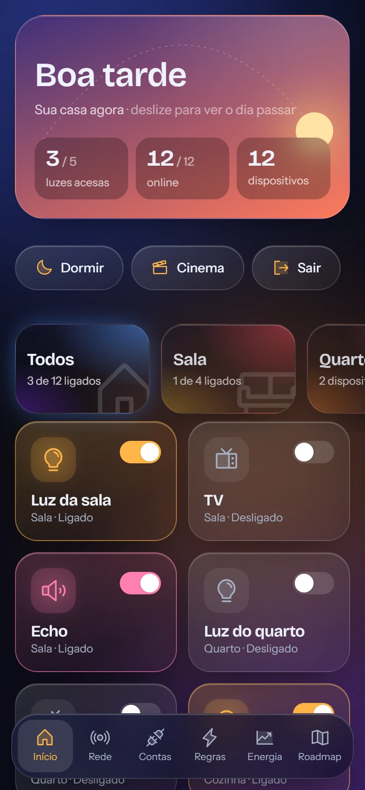
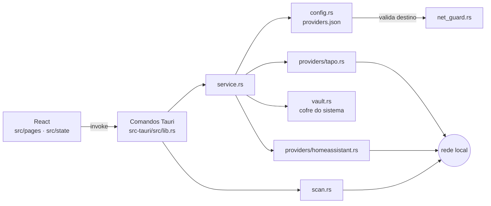

<div align="center">


# Casa

**Home assistant para desktop e celular, escrito uma vez em Tauri, React e Tailwind.**<br/>
Liga e desliga tomadas Tapo e entidades do Home Assistant com credenciais guardadas no cofre do sistema, e mapeia a sua rede local sem enviar nada para a nuvem.


<sub><a href="#instalar">Instalar</a> · <a href="#tour">Tour</a> · <a href="#como-funciona">Como funciona</a> · <a href="#limites-conhecidos">Limites</a></sub>

<br/>



</div>

> Painel que mostra o estado da casa, comanda aparelhos com um toque e põe a rede num radar. O controle
> de Tapo e Home Assistant está implementado; sem um provedor cadastrado, o painel usa dados de demonstração.

## Por que o Casa

O escopo é pequeno de propósito: **controlar o que dá para provar** e dizer com clareza o que ainda não dá. Nada passa por servidor externo, e o app não tem conta própria.

🔐 **Credenciais fora do alcance da interface.** Senha e token vão para o cofre do sistema e só o código Rust os lê. A tela consegue gravar, apagar e perguntar se existe um segredo, nunca ler.

🛰️ **Rede mapeada sem autenticar nada.** A varredura usa conexão TCP, tabela ARP e o cabeçalho `Server` do HTTP, e explica por que classificou cada dispositivo daquele jeito.

🧪 **Testado contra aparelhos simulados.** O protocolo da Tapo é exercitado por um dispositivo falso dentro dos testes, e o fluxo completo roda no app real com um Home Assistant falso e o cofre verdadeiro do Windows.

## Tour

<table>
<tr>
<td width="50%"><br/><b>Rede</b> &ndash; radar dos hosts da sub-rede e o motivo de cada classificação.</td>
<td width="50%"><br/><b>Automações</b> &ndash; gatilho, condição e ação, com cascata limitada a cinco níveis.</td>
</tr>
<tr>
<td width="50%"><br/><b>Energia</b> &ndash; curva do dia e consumo por aparelho, ainda com série simulada.</td>
<td width="50%"><br/><b>Roadmap</b> &ndash; 113 features com viabilidade, busca e filtro por categoria.</td>
</tr>
</table>

<details>
<summary>📱 No celular: a barra inferior substitui a lateral</summary>

<br/>



</details>

<sub>As capturas usam a interface real em modo demonstração, com dispositivos e endereços fictícios, e um relógio fixado às 17:40 para o céu ficar igual a cada execução.</sub>

## Instalar

Ainda não há instaladores publicados. O app roda a partir do código.

Pré-requisitos: [Bun](https://bun.sh) 1.3, [Rust](https://rustup.rs) estável e as [dependências do Tauri](https://v2.tauri.app/start/prerequisites/) do seu sistema (no Windows, o WebView2).

```sh
git clone https://github.com/juninmd/casa.git
cd casa
bun install
bun run dev            # navegador, modo demonstração com uma rede de exemplo
bun run tauri dev      # app desktop, varredura nativa e provedores reais
```

> [!NOTE]
> Provedores reais só existem no app desktop. No navegador os botões de cadastro ficam desabilitados, porque o cofre do sistema não é acessível por uma página web.

## Usar

1. Abra **Provedores** e escolha **Tapo** ou **Home Assistant**.
2. Tapo: informe os IPs (ou use o botão que importa os Tapo achados na varredura), o e-mail e a senha da conta TP-Link. Home Assistant: a URL e um token de acesso de longa duração.
3. Clique em **Salvar e testar**. O resultado aparece na hora, por exemplo:

```text
3 dispositivo(s) acessíveis
```

Depois disso os dispositivos entram no painel e o botão de cada cartão passa a comandar o aparelho real. Fechaduras do Home Assistant aparecem somente para leitura.

## Como funciona



Fluxo de um comando: a interface chama um comando Tauri, `service.rs` lê a configuração, busca o segredo no cofre e entrega os dois ao provedor, que fala com o aparelho. Depois do comando o estado é lido de volta, então o cartão só mostra "ligado" quando o aparelho confirma.

- A Tapo usa o handshake RSA seguido de AES-128-CBC e `securePassthrough`, verificado contra o `python-kasa`. O login tenta primeiro o hash da senha da versão 2 e cai para a versão 1.
- A varredura sonda as portas de um host em sequência e só paraleliza entre hosts. Disparar 30 conexões por host de uma vez perdia as portas dos aparelhos IoT.
- O classificador (`src/core/classify.ts`) cruza o fabricante do MAC (tabela pública da IEEE em `src/data/oui-iot.json`, gerada por `bun run gen:oui`), as portas abertas e o banner HTTP.

## Desenvolver

```sh
bun install                          # dependências
bun run lint                         # Biome em src e scripts
bun test                             # 22 testes de lógica pura (classificador, automação, sincronização)
bun run build                        # tsc + bundle de produção em dist/
bun run tauri dev                    # app desktop com recarga
bun run tauri build --debug --no-bundle   # binário de depuração em src-tauri/target/debug
bun run gen:oui                      # regera src/data/oui-iot.json a partir da lista da IEEE
bun run screenshots                  # regera .github/assets/screenshots com a UI real em modo demo
cd src-tauri && cargo test --lib     # 31 testes Rust (3 ignorados: cofre real, varredura real, provedor real)
```

A varredura real e a leitura de um provedor real ficam fora da suíte padrão, porque dependem da sua rede e do seu cofre:

```sh
cd src-tauri
CASA_TEST_PREFIX=192.168.1 cargo test --lib -- --ignored --nocapture sweep      # varre a sub-rede informada
CASA_LIVE_PROVIDER=<id> cargo test --lib live_provider -- --ignored --nocapture # só leitura, não liga nada
```

`bun run screenshots` precisa de um Chromium ou Edge instalado; defina `CHROME_PATH` se ele não estiver num caminho comum.

### Estrutura

| Pasta | Conteúdo |
|---|---|
| `src/core` | classificador de dispositivos e motor de automação, com testes |
| `src/state`, `src/platform` | store (zustand), sincronização com provedores e chamadas `invoke` |
| `src/pages`, `src/ui` | telas e componentes de vidro, céu, radar e cartões |
| `src-tauri/src` | varredura, cofre, validação de rede, serviço e provedores |
| `research/` | levantamento de features em outras plataformas |
| `scripts/` | scan de referência em PowerShell, gerador de OUI e capturas |

## Contribuir

Commits seguem Conventional Commits, um assunto por commit, com o motivo no corpo. Antes de abrir um PR rode `bun run lint`, `bun test` e `cargo test --lib`.

## Documentação

| Documento | Conteúdo |
|---|---|
| 📖 [Home Assistant](research/01-home-assistant.md) | features, APIs REST e WebSocket levantadas na documentação oficial |
| 🧭 [Outras plataformas](research/02-outras-plataformas.md) | openHAB, Domoticz, ioBroker, Jeedom, Gladys, Homebridge e dashboards de homelab |

## Segurança

| Camada | Proteção |
|---|---|
| Cofre | segredos no Credential Manager (Windows), Keychain (macOS) ou Secret Service (Linux); a interface só grava, apaga e consulta se existe; o `Debug` de `Secret` é redigido |
| Destino | só IPv4 privado na porta 80 para Tapo; `http` apenas para endereços locais, `https` para qualquer um; URL sem usuário, senha, query ou fragmento |
| Vínculo | o segredo guardado fica preso ao destino: mudar o IP ou a URL exige digitar a credencial de novo |
| Rede | requisições sem proxy do sistema e sem seguir redirecionamentos |
| Comandos | Home Assistant só aceita domínios que ligam e desligam; fechaduras ficam somente leitura |
| Falha de login | depois de uma recusa, o app para de tentar até você corrigir a credencial, para não repetir tentativas com uma credencial errada |

## Limites conhecidos

- **Tapo com KLAP não funciona.** Tomadas mais novas respondem 403 ao handshake antigo. O controle foi exercitado contra um aparelho simulado, não contra hardware real.
- **Energia é simulada.** A curva e o consumo por aparelho vêm de uma série fixa; medidores como o Tapo P110 e o Shelly ainda não estão ligados.
- **Faltam integrações.** Tuya (exige a chave local), câmeras RTSP e o WebSocket do Home Assistant não existem.
- **Celular não foi testado.** Não houve build Android ou iOS. O cofre no Android é um esboço que devolve erro, e em celulares a varredura se reduz a TCP, sem ARP nem ICMP.
- **Classificação é hipótese.** Fabricante, portas e banner indicam o tipo do aparelho, mas nada é autenticado para confirmar.
- **Downgrade da Tapo v2 para v1.** Aceito como risco conhecido enquanto o KLAP não for implementado.

## Inspirações

Levantamento feito em 2026-11-01 sobre a documentação pública de cada projeto.

| Projeto | O que entrou no Casa |
|---|---|
| [Home Assistant](https://www.home-assistant.io) | modelo de entidades e estado, automação em gatilho, condição e ação, REST como primeira integração |
| [python-kasa](https://github.com/python-kasa/python-kasa) | referência para conferir o handshake e o login da Tapo |
| openHAB, Domoticz, ioBroker, Jeedom, Gladys, Homebridge | a lista de 113 features do [roadmap](research/02-outras-plataformas.md) |

## Licença

Ainda não definida. Até que um arquivo `LICENSE` seja adicionado, vale o padrão do GitHub: todos os direitos reservados ao autor.
